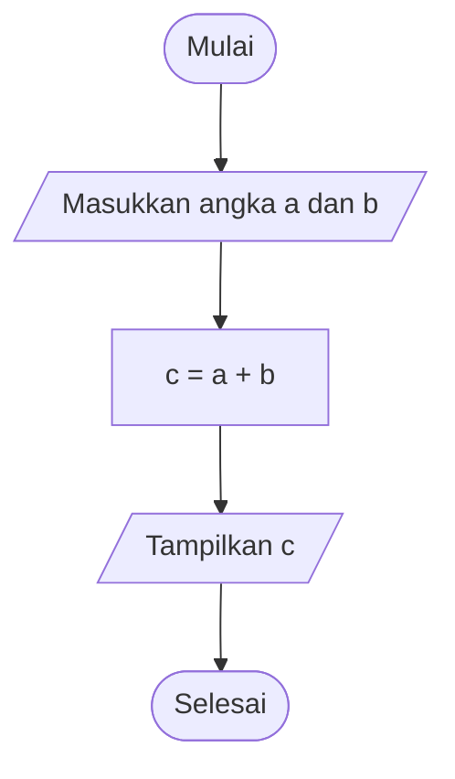

# Pertemuan 2 — Flowchart dan Pseudocode

Pada pertemuan pertama, kita sudah mengenal konsep algoritma dan bagaimana algoritma digunakan untuk menyelesaikan masalah.

Sekarang, kita akan mempelajari cara **menggambarkan dan menuliskan algoritma** agar langkah-langkah penyelesaian masalah lebih mudah dipahami sebelum diterapkan ke dalam program.

Ada dua cara yang akan dibahas pada materi ini, yaitu:

- **Flowchart:** menggambarkan alur algoritma menggunakan simbol dan panah.
- **Pseudocode:** menuliskan langkah-langkah algoritma menggunakan bahasa sederhana yang menyerupai struktur program.

Keduanya membantu kita merancang solusi secara terstruktur sebelum mulai menulis kode menggunakan bahasa pemrograman seperti C++ atau Python.

## 📚 Daftar Isi

1. [Apa Itu Flowchart?](#1-apa-itu-flowchart)
2. [Simbol-Simbol Flowchart](#2-simbol-simbol-flowchart)
3. [Contoh Flowchart](#3-contoh-flowchart)
4. [Apa Itu Pseudocode?](#4-apa-itu-pseudocode)
5. [Struktur Pseudocode](#5-struktur-pseudocode)
6. [Contoh Pseudocode](#6-contoh-pseudocode)
7. [Perbedaan Flowchart dan Pseudocode](#7-perbedaan-flowchart-dan-pseudocode)
8. [Hal yang Perlu Diperhatikan](#8-hal-yang-perlu-diperhatikan)
9. [Kesimpulan](#9-kesimpulan)
10. [Latihan Pemahaman](#10-latihan-pemahaman)

---

## 1. Apa Itu Flowchart?

**Flowchart atau diagram alir adalah representasi visual dari langkah-langkah penyelesaian masalah atau algoritma menggunakan simbol-simbol tertentu yang dihubungkan oleh garis atau panah.**

Sederhananya, flowchart membantu kita melihat alur sebuah proses dari awal sampai akhir tanpa harus membaca penjelasan yang panjang.

Bayangkan kamu ingin membuat teh. Kamu dapat menggambarkan prosesnya menggunakan simbol yang menunjukkan awal, aktivitas, dan akhir. Jika terdapat pilihan atau kondisi tertentu, kamu juga dapat menggambarkannya melalui simbol keputusan.

### Mengapa flowchart digunakan?

Flowchart memiliki beberapa kegunaan:

- Mempermudah pemahaman terhadap urutan langkah algoritma.
- Membantu menggambarkan alur logika sebelum program dibuat.
- Mempermudah identifikasi kesalahan dalam alur penyelesaian masalah.
- Membantu menjelaskan cara kerja suatu algoritma kepada orang lain.
- Mendokumentasikan alur program yang akan dibuat atau yang sudah tersedia.

Dengan flowchart, kita dapat memeriksa apakah alur penyelesaian masalah sudah benar sebelum menerjemahkannya menjadi kode program.

---

## 2. Simbol-Simbol Flowchart

Dalam flowchart, setiap simbol memiliki fungsi yang berbeda. Karena itu, penggunaan simbol harus sesuai dengan aktivitas yang ingin digambarkan.

Berikut simbol-simbol yang dibahas dalam materi perkuliahan.

| Simbol | Nama | Fungsi |
|---|---|---|
| Oval atau persegi panjang membulat | Start / End (Terminator) | Menandai awal atau akhir proses. |
| Persegi panjang | Process (Processor) | Menunjukkan proses pengolahan data atau pelaksanaan instruksi. |
| Belah ketupat | Decision | Menunjukkan pengambilan keputusan berdasarkan kondisi. |
| Jajar genjang | Input / Output | Menunjukkan proses menerima masukan atau menampilkan keluaran. |
| Simbol dokumen | Document | Menunjukkan proses menghasilkan atau mencetak dokumen. |
| Garis berpanah | Flowline / Line Connector | Menunjukkan arah alur dari satu langkah ke langkah berikutnya. |
| Loop Connector | Loop Connector | Menunjukkan penghubung alur pada proses perulangan, sesuai notasi yang digunakan. |

### 2.1. Start / End (Terminator)

Digunakan untuk menandai titik awal dan akhir sebuah flowchart.

Contoh teks di dalam simbol:

- `Mulai`
- `Selesai`

Setiap flowchart perlu memiliki alur awal yang jelas dan menunjukkan kapan proses berakhir.

### 2.2. Process (Processor)

Digunakan untuk menggambarkan proses pengolahan data atau instruksi.

Contoh:

`c = a + b`

Instruksi tersebut menunjukkan bahwa nilai `a` dan `b` dijumlahkan, kemudian hasilnya disimpan ke variabel `c`.

### 2.3. Decision

Digunakan ketika algoritma harus menentukan langkah berikutnya berdasarkan suatu kondisi.

Contoh:

`Apakah nilai >= 60?`

Kondisi tersebut dapat menghasilkan dua kemungkinan:

- Ya: tampilkan status lulus.
- Tidak: tampilkan status belum lulus.

### 2.4. Input / Output

Digunakan untuk menunjukkan proses menerima data atau menampilkan hasil.

Contoh input:

`Masukkan nilai a dan b`

Contoh output:

`Tampilkan hasil penjumlahan`

### 2.5. Document

Digunakan untuk menunjukkan proses menghasilkan atau mencetak dokumen fisik.

Contohnya, sebuah sistem mencetak laporan hasil perhitungan.

### 2.6. Line Connector

Garis berpanah menunjukkan arah jalannya algoritma. Panah membantu pembaca mengetahui langkah mana yang harus diikuti setelah langkah sebelumnya.

### 2.7. Loop Connector

Digunakan dalam notasi flowchart untuk membantu menghubungkan alur perulangan. Detail penggunaannya mengikuti konvensi simbol yang digunakan pada materi atau perangkat pembuat flowchart.

**Hal penting:** jangan hanya menghafal bentuk simbol. Pahami fungsi setiap simbol agar flowchart yang dibuat dapat dibaca dengan benar.

---

## 3. Contoh Flowchart

Sekarang kita akan mencoba memahami flowchart melalui contoh sederhana.

### Kasus: Menghitung Penjumlahan Dua Angka

Misalnya, kita ingin membuat algoritma untuk menjumlahkan dua angka yang dimasukkan oleh pengguna.

Langkah-langkahnya:

1. Mulai.
2. Masukkan angka pertama (`a`).
3. Masukkan angka kedua (`b`).
4. Jumlahkan kedua angka dan simpan hasilnya ke `c`.
5. Tampilkan hasil penjumlahan.
6. Selesai.

### Gambaran flowchart

Diagram berikut menggunakan sintaks Mermaid. Pada GitHub, diagram akan tampil secara visual jika ditampilkan melalui fitur Markdown Preview yang mendukung Mermaid.



### Cara membaca flowchart

- **Mulai:** proses dimulai.
- **Masukkan angka a dan b:** program menerima dua angka.
- **c = a + b:** kedua angka dijumlahkan.
- **Tampilkan c:** hasil penjumlahan ditampilkan.
- **Selesai:** proses berakhir.

Contohnya, jika `a = 5` dan `b = 3`, hasil perhitungan adalah `c = 8`.

Perhatikan bahwa flowchart menggambarkan urutan proses secara visual. Kita dapat mengetahui apa yang dilakukan terlebih dahulu, apa yang diproses, dan hasil apa yang ditampilkan.

---

## 4. Apa Itu Pseudocode?

**Pseudocode adalah cara menuliskan langkah-langkah algoritma menggunakan bahasa yang sederhana dan menyerupai struktur bahasa pemrograman, tanpa harus mengikuti aturan sintaks bahasa pemrograman tertentu secara ketat.**

Pseudocode sering digunakan untuk menjelaskan logika program sebelum menulis kode yang sebenarnya.

Misalnya, kita ingin membuat program penjumlahan dua angka.

Pseudocode-nya dapat ditulis seperti berikut:

```text
MULAI
    BACA a
    BACA b
    c = a + b
    TAMPILKAN c
SELESAI
```

Dari contoh tersebut, kita dapat memahami bahwa algoritma menerima dua angka, menjumlahkannya, lalu menampilkan hasilnya.

Penulisan pseudocode tidak harus menggunakan satu format yang berlaku untuk semua bahasa atau perangkat. Yang terpenting, langkah-langkahnya jelas, logis, dan mudah dipahami.

### Tujuan penggunaan pseudocode

Pseudocode memiliki beberapa tujuan:

1. **Mudah dibaca:** menggunakan bahasa yang lebih sederhana daripada kode program.
2. **Mudah dipahami:** pembaca dapat mengikuti logika tanpa harus menguasai sintaks bahasa tertentu.
3. **Membantu menuangkan ide:** programmer dapat merancang solusi terlebih dahulu sebelum menulis kode.
4. **Mempermudah penerjemahan ke program:** langkah yang sudah dirancang dapat diimplementasikan ke C++, Python, atau bahasa lainnya.

---

## 5. Struktur Pseudocode

Berdasarkan materi perkuliahan, pseudocode memiliki tiga bagian utama: judul, deskripsi, dan implementasi.

### 5.1. Judul

Judul menunjukkan nama atau tujuan algoritma yang dibuat.

Contoh:

`Algoritma Penjumlahan Dua Angka`

Judul membantu pembaca mengetahui masalah yang akan diselesaikan.

### 5.2. Deskripsi

Bagian deskripsi berisi deklarasi variabel atau konstanta yang diperlukan dalam algoritma.

Variabel adalah tempat untuk menyimpan nilai yang dapat digunakan dalam proses.

Contoh:

- `a`: menyimpan angka pertama.
- `b`: menyimpan angka kedua.
- `c`: menyimpan hasil penjumlahan.

### 5.3. Implementasi

Bagian implementasi berisi langkah-langkah utama untuk menyelesaikan masalah.

Contohnya:

1. Membaca nilai `a`.
2. Membaca nilai `b`.
3. Menghitung `c = a + b`.
4. Menampilkan nilai `c`.

### Contoh struktur lengkap

```text
ALGORITMA Penjumlahan_Dua_Angka

DESKRIPSI
    a, b, c : bilangan

IMPLEMENTASI
    BACA a
    BACA b
    c = a + b
    TAMPILKAN c
```

Contoh ini merupakan salah satu cara penulisan pseudocode. Istilah dan format deklarasi dapat berbeda tergantung konvensi yang diajarkan.

---

## 6. Contoh Pseudocode

Supaya lebih mudah memahami pseudocode, perhatikan beberapa contoh berikut.

### 6.1. Penjumlahan Dua Angka

**Tujuan:** menghitung jumlah dari dua angka.

Pseudocode:

```text
ALGORITMA Penjumlahan

DESKRIPSI
    a, b, c : bilangan

IMPLEMENTASI
    BACA a
    BACA b
    c = a + b
    TAMPILKAN c
```

Simulasi:

- Input `a = 5`
- Input `b = 3`
- Hitung `c = 5 + 3`
- Output `8`

Dari contoh tersebut, kita dapat melihat hubungan antara input, proses, dan output.

### 6.2. Menentukan Kelulusan

**Tujuan:** menentukan status mahasiswa berdasarkan nilai.

Misalkan batas kelulusan dalam contoh ini adalah 60. Angka tersebut hanya contoh untuk latihan, bukan ketentuan resmi mata kuliah.

Pseudocode:

```text
ALGORITMA Cek_Kelulusan

DESKRIPSI
    nilai : bilangan

IMPLEMENTASI
    BACA nilai

    JIKA nilai >= 60 MAKA
        TAMPILKAN "Lulus"
    JIKA TIDAK
        TAMPILKAN "Belum lulus"
    AKHIR JIKA
```

Simulasi:

- Jika nilai `80`, hasilnya `Lulus`.
- Jika nilai `50`, hasilnya `Belum lulus`.
- Jika nilai `60`, hasilnya `Lulus`, karena kondisi menggunakan `>=`.

Contoh ini menunjukkan bahwa pseudocode dapat menggambarkan pengambilan keputusan, bukan hanya perhitungan.

### 6.3. Hubungan Pseudocode dengan Flowchart

Untuk masalah yang sama, pseudocode dan flowchart dapat menggambarkan logika yang sama dalam dua bentuk berbeda.

Pseudocode penjumlahan:

```text
MULAI
    BACA a
    BACA b
    c = a + b
    TAMPILKAN c
SELESAI
```

Flowchart-nya terdiri dari simbol mulai, input, proses, output, dan selesai.

Dengan kata lain, **logikanya tetap sama, tetapi cara penyajiannya berbeda**.

---

## 7. Perbedaan Flowchart dan Pseudocode

Keduanya digunakan untuk merancang dan menjelaskan algoritma, tetapi memiliki bentuk penyajian yang berbeda.

| Aspek | Flowchart | Pseudocode |
|---|---|---|
| Bentuk | Diagram visual | Teks terstruktur |
| Penyajian | Menggunakan simbol dan panah | Menggunakan instruksi atau kalimat sederhana |
| Fokus | Memperlihatkan alur proses | Menjelaskan langkah dan logika |
| Kemudahan | Membantu melihat alur secara visual | Membantu merancang logika secara terperinci |
| Perubahan | Diagram perlu disesuaikan jika alur berubah | Teks dapat diedit langsung |
| Hubungan dengan kode | Menggambarkan urutan proses | Menyerupai struktur instruksi program |

### Kapan menggunakan flowchart?

Gunakan flowchart ketika ingin menggambarkan urutan proses secara visual, terutama ketika terdapat banyak langkah, percabangan, atau perulangan.

### Kapan menggunakan pseudocode?

Gunakan pseudocode ketika ingin menuliskan logika penyelesaian masalah secara terstruktur sebelum diterjemahkan ke dalam kode program.

Keduanya juga dapat digunakan bersamaan. Kita bisa merancang flowchart terlebih dahulu, kemudian menuliskan pseudocode berdasarkan alur tersebut, atau sebaliknya.

---

## 8. Hal yang Perlu Diperhatikan

Ada beberapa hal yang perlu diperhatikan ketika membuat flowchart dan pseudocode.

### 8.1. Pastikan Urutan Langkah Logis

Langkah-langkah harus disusun sesuai urutan penyelesaian masalah.

Untuk penjumlahan dua angka, misalnya, kita harus menerima angka terlebih dahulu sebelum menjumlahkannya.

### 8.2. Gunakan Simbol Flowchart Sesuai Fungsinya

Jangan menggunakan simbol keputusan untuk menggambarkan perhitungan biasa. Gunakan simbol proses untuk perhitungan dan simbol keputusan ketika memeriksa kondisi.

### 8.3. Bedakan Variabel dan Teks

Pada contoh PPT terdapat langkah `Print "c"`. Dalam penulisan pseudocode, tanda kutip biasanya menunjukkan teks literal.

- `TAMPILKAN c` berarti menampilkan nilai yang tersimpan dalam variabel `c`.
- `TAMPILKAN "c"` berarti menampilkan huruf `c` sebagai teks.

Perbedaan ini penting ketika nantinya kita menerjemahkan pseudocode menjadi kode program.

### 8.4. Perhatikan Makna Kondisi dan Boolean

Boolean merupakan tipe nilai logika yang memiliki dua kemungkinan, yaitu benar (*True*) dan salah (*False*).

Misalnya, kondisi `nilai >= 60` akan bernilai benar jika nilai setidaknya 60, dan salah jika kurang dari 60.

Ketika membuat algoritma, jangan mengubah makna suatu kondisi karena dapat menyebabkan keputusan yang dihasilkan menjadi berbeda.

### 8.5. Pastikan Proses Memiliki Awal dan Akhir

Flowchart perlu menunjukkan awal dan akhir proses dengan jelas. Pseudocode juga sebaiknya memiliki penanda mulai dan selesai agar urutan algoritmanya mudah diikuti.

---

## 9. Kesimpulan

Dari materi pertemuan kedua, terdapat beberapa poin penting yang perlu diingat:

1. Flowchart adalah diagram yang menggambarkan alur algoritma menggunakan simbol dan panah.
2. Setiap simbol flowchart memiliki fungsi tertentu, seperti proses, input/output, keputusan, dan terminator.
3. Pseudocode adalah penulisan algoritma dalam bentuk teks terstruktur yang mudah dipahami manusia.
4. Struktur pseudocode dalam materi ini terdiri dari judul, deskripsi, dan implementasi.
5. Flowchart dan pseudocode memiliki bentuk berbeda, tetapi dapat menggambarkan logika penyelesaian masalah yang sama.
6. Keduanya membantu kita merancang solusi sebelum menerapkannya ke dalam kode program.

**Inti materi:** sebelum menulis kode, pahami dahulu langkah penyelesaian masalahnya. Flowchart membantu kita melihat alurnya, sedangkan pseudocode membantu kita menuliskan logikanya.

---

## 10. Latihan Pemahaman

Coba jawab pertanyaan berikut untuk menguji pemahamanmu.

1. Apa yang dimaksud dengan flowchart?
2. Apa fungsi simbol *Decision* dalam flowchart?
3. Apa perbedaan simbol *Process* dan *Input/Output*?
4. Jelaskan pengertian pseudocode dengan bahasamu sendiri.
5. Sebutkan tiga bagian struktur pseudocode berdasarkan materi perkuliahan.
6. Apa perbedaan antara `TAMPILKAN c` dan `TAMPILKAN "c"`?
7. Buatlah pseudocode untuk menghitung luas persegi panjang dengan rumus panjang × lebar.
8. Gambarkan flowchart sederhana untuk menentukan apakah sebuah angka lebih besar dari nol.

**Tantangan tambahan:** pilih satu kegiatan sehari-hari, kemudian buat pseudocode dan flowchart yang menggambarkan langkah-langkahnya.

Jika kamu bisa membuat keduanya dengan logika yang sama, berarti kamu sudah mulai memahami cara merepresentasikan algoritma sebelum masuk ke tahap pemrograman.

---

**Materi selanjutnya:** ikuti topik pada PPT pertemuan berikutnya.

Terus berlatih, karena kemampuan menyusun algoritma akan menjadi fondasi penting dalam mempelajari pemrograman. 🚀
